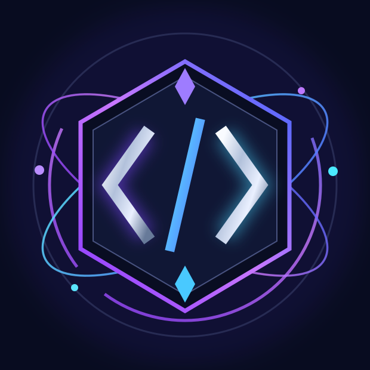

  

<h1 align="center">WMK CodeVerse</h1>

<strong>Uma engine. Sua linguagem. Seu universo.</strong>

<em>One Engine. Your Language. Your Universe.</em>

Projeto aberto para ampliar as possibilidades de programação na Godot Engine.

---

## O que é o WMK CodeVerse?

O **WMK CodeVerse** é um projeto comunitário e de código aberto baseado na [Godot Engine](https://godotengine.org/). Sua proposta é permitir que desenvolvedores criem jogos utilizando a linguagem com a qual se sentem mais produtivos, aproveitando o mesmo editor visual, nós, cenas, animação, física e renderização.

> **Estado atual:** este repositório tem uma base histórica do **Godot 4.4 dev**. **A edição multilinguagem ainda não está validada como executável pronto.** As integrações experimentais devem ser testadas e compiladas antes de serem anunciadas como funcionais.

## WMK PolyCode — Tecnologia de Integração e Extensibilidade

**WMK PolyCode** é o nome dado à nossa proposta de arquitetura para investigar os mecanismos de extensão de softwares, conectar linguagens de programação, runtimes, APIs, servidores MCP e provedores de inteligência artificial por meio de adaptadores específicos.

**Visão:** *Conectando motores, linguagens e inteligência artificial.*

O **WMK CodeVerse** é o primeiro laboratório dessa arquitetura, com destaque para o **Portugol 🇧🇷**. PolyCode não é uma nova linguagem nem uma camada universal já pronta: é um conceito de engenharia em desenvolvimento, que depende de APIs, contratos, permissões e testes reais para cada aplicação.

- **[Conheça o WMK PolyCode — documento técnico completo em HTML](manuais/wmk-polycode.html)**
- **Idealização e direção do conceito:** Walney Moreira Klein — **walneyk@hotmail.com**.
- **Desenvolvimento inicial:** integrações experimentais de linguagens, Portugol, IA e MCP no CodeVerse; reutilização fora do Godot ainda não validada.

## Linguagens e possibilidades

**🇧🇷 Destaque: Portugol aparece primeiro!** Nossa proposta educacional permite escrever um subconjunto de comandos em português e convertê-los em GDScript. Ainda não significa que arquivos `.por` sejam executados diretamente pelo editor.

| Linguagem | Tecnologia de integração | Estado no projeto |
| --- | --- | --- |
| **Portugol 🇧🇷** | [WMK Portugol](wmk-portugol/README.md): transpilador educacional para GDScript | Primeira versão publicada; testes Python aprovados; integração nativa ao editor pendente |
| **GDScript** | Sistema de scripts padrão Godot | Disponível na base |
| **C#** | Godot .NET / módulo Mono | Suporte existente no ecossistema Godot; build WMK pendente |
| **JavaScript** | [GodotJS](https://github.com/godotjs/GodotJS) | Integração experimental |
| **TypeScript** | GodotJS + compilação TS para JS | Integração experimental |
| **Lua** | Lua GDExtension | Integração experimental por projeto |
| **C++** | Módulos C++ ou [godot-cpp/GDExtension](https://github.com/godotengine/godot-cpp) | Caminho existente para código nativo |
| **Rust** | [godot-rust/gdext](https://github.com/godot-rust/gdext) | Possibilidade futura |
| **Python** | Binding comunitário, como [py4godot](https://github.com/niklas2902/py4godot) | Possibilidade futura |

**Importante:** linguagens compiladas como C++ e Rust normalmente utilizam bibliotecas nativas. Não é necessário reescrever a física, os nós e a renderização em cada linguagem; são necessárias pontes (bindings) entre o runtime e a API do Godot.

## 📚 Manuais em português (Brasil)

Toda a documentação WMK começa em **[Biblioteca de Manuais](manuais/README.md)**.

| Manual | Para quem | O que ensina |
| --- | --- | --- |
| **[WMK PolyCode — arquitetura e visão (HTML)](manuais/wmk-polycode.html)** | Desenvolvedores e pesquisadores | Extensibilidade, linguagens, runtimes, APIs, MCP, IA, adaptadores, segurança e roadmap |
| **[WMK Portugol — programar em português](wmk-portugol/README.md)** | Iniciantes, professores e programadores | Sintaxe, conversão para GDScript, exemplos e testes |
| **[Primeiros passos](manuais/primeiros-passos.md)** | Iniciantes e usuários | Editor, projetos, cenas, nós, scripts, primeiro exemplo |
| **[Guia de linguagens](manuais/guia-de-linguagens.md)** | Programadores | Diferenças entre GDScript, C#, JS, TS, Lua, C++, Rust e Python |
| **[Integrar uma nova linguagem](manuais/integrar-nova-linguagem.md)** | Desenvolvedores da engine | `ScriptLanguage`, módulos, GDExtension, bindings, runtime, testes |
| **[Validação e publicação](manuais/validacao-e-publicacao.md)** | Mantenedores | Compilação, matriz de testes, exportação, licenças e releases |

### Para quem quer colocar sua própria linguagem no Godot

O guia **[Como integrar uma nova linguagem](manuais/integrar-nova-linguagem.md)** mostra a arquitetura real do Godot e a diferença entre:
1. Registrar uma **linguagem de script** diretamente no editor;
2. Criar uma **GDExtension** para expor novas classes nativas;
3. Integrar um **módulo C++** à compilação da engine.

Além de exemplos, apresenta o que precisa funcionar para que uma linguagem possa ser considerada integrada: carregamento de scripts, nós, propriedades, sinais, erros, depuração, exportação e testes automatizados.

## 🇧🇷 WMK Portugol — jogos com comandos em português

O CodeVerse possui um primeiro **compilador educacional Portugol → GDScript**, com exemplo, testes Python e workflow próprio. Ainda não é um runtime incorporado ao editor nem uma implementação completa de Portugol Studio.

- [Manual e instalação do WMK Portugol](wmk-portugol/README.md)
- [Código do compilador](wmk-portugol/compilador.py)
- [Exemplo de programa](wmk-portugol/exemplos/ola_mundo.por)

## IA integrada, MCP e provedores (protótipo)

O projeto já possui um servidor MCP de **somente leitura** e clientes CLI iniciais para **Ollama, Groq, OpenAI e Gemini**. **Ainda não há painel integrado ao editor nem validação de execução desses componentes.**

- [Guia de instalação da IA e do servidor MCP](wmk-ai/README.md)
- [Manual de arquitetura de IA e MCP](manuais/ia-mcp.md)

## 🇧🇷 Tradução pt-BR

O README e os manuais WMK são escritos em português (Brasil). O **Godot já possui tradução da interface** e normalmente permite escolher o idioma nas configurações do editor; traduções de módulos de terceiros podem ser parciais. **A interface do fork ainda não foi auditada nem traduzida integralmente.**

## Identidade visual

O símbolo do **WMK CodeVerse** usa o conceito universal de **código** (`</>`), um núcleo geométrico e órbitas que representam diversas linguagens conectadas à mesma engine, sem nomes de linguagens no logotipo.

- [Emblema WMK CodeVerse (SVG)](branding/wmk-codeverse-icon.svg)

## Código aberto, créditos e licenciamento

**Idealização e personalização WMK:** Walney Moreira Klein — **walneyk@hotmail.com**.

O projeto é derivado do **Godot Engine**, software livre sob licença MIT. Todas as licenças e avisos originais devem ser preservados, assim como os avisos das integrações de terceiros. O WMK CodeVerse é independente da Godot Foundation e não deve ser confundido com uma versão oficial do Godot.

- [Projeto original Godot](https://github.com/godotengine/godot)
- [Documentação Godot em português](https://docs.godotengine.org/pt-br/stable/)
- [Licença deste repositório](LICENSE.txt)

## Roteiro de desenvolvimento

**Prioridade:** compilar a distribuição, validar uma cena por linguagem, preparar templates de exportação e somente então publicar executáveis marcados como estáveis.

**Contribuições são bem-vindas**, especialmente para novas integrações de linguagem, traduções, exemplos, documentação e testes reproduzíveis.
